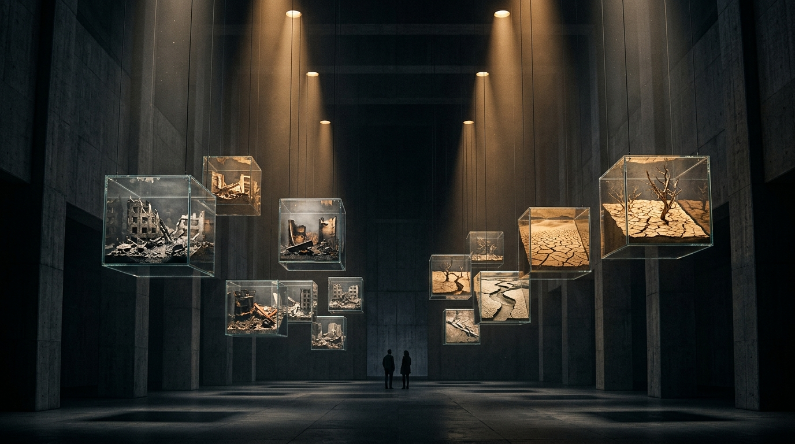

# 📋 組內討論與決策紀錄 (Decision Log)

> **所屬專案**：[[00_Creativity_and_Innovation_Final_Report_期末報告總覽|回期末報告總覽]]
> **GitHub 倉庫**：[ludylan/Creative-Innovation-Final-Project](https://github.com/ludylan/Creative-Innovation-Final-Project)
> **網頁版提案週專區 (Proposal Hub)**：[`index.html`](./index.html)（含互動式模板與個人展示空間）

---

## 📢 當前階段：提案週 (Proposal Week) 任務與規範

本專案為**前沿探索性專案**，核心形式定調為：**以網頁前端技術製作約 5～7 分鐘的純動畫繪本（非純 AI 生成影片）**。

### 📌 本週（W10–W11）首要定案任務（尚未決策項目）：
1. **多元美術思路與風格定稿**：不侷限於傳統 2D 手繪動畫，積極探索 **GPU 即時渲染場景 (WebGL / WebGPU / Three.js / Shader 著色器光影)**、生成式場景等多元視覺方案，彙整各方視覺參考圖片確立色票與技術分層。
2. **具體網頁技術棧選型**：純 SVG+CSS、HTML5 Canvas、還是引入 GPU 渲染引擎（如 Three.js / Pixi.js / GSAP）？效能與實現邊界為何？
3. **劇情內容與立意點收斂**：全片情節脈絡、主角設定、**為什麼需要這段劇情？**想傳達什麼哲理與寓意？

### 🤖 AI 協作者角色與提案準則（說故事級情境，大膽妄想，落地為真）：
* **鼓勵大膽妄想**：組員不必自我設限，盡情提出任何童趣、奇幻或富有科技哲理的互動場景構想。
* **AI 扮演技術探路先鋒與架構師**：
  1. **實際技術分析與可行性查核**：AI 必須實事求是、深入檢索前端 API 與瀏覽器/GPU 效能極限，**嚴禁盲目捏造或唬爛**！尋找現成開源案例（CodePen、Shadertoy、Three.js、GitHub）作為參考，並提出效能優化與降階空間。
  2. **多元前沿美術思路**：提供具體的美術思路（不限於傳統手繪，包含 GPU 即時光影、低多邊形、粒子幾何等），附上明確色票與圖層代碼拆分規劃。
  3. **提煉劇情深度與核心立意**：為情節挖掘深刻的人文、哲學或情感價值，回答「為什麼需要這個故事？」。
  4. **收整為符合報告規格**：整理成符合大學課程報告高標準的完整提案文件。

### 📂 提案工具與模組專區檔案（最新擴充提案清單）：
* 🤖 **AI 協作提示詞指南**：[`01_AI_Collaboration_Prompt_AI協作提示詞指南.md`](./01_AI_Collaboration_Prompt_AI協作提示詞指南.md)（完整說故事級 Prompt、雙向互動規範與四階查核）
* 📖 **模組 A 故事劇情專區**：
  * [`01_Module_A_Story_故事劇情/Module_A_Proposal_01_平面與立體.html`](./01_Module_A_Story_故事劇情/Module_A_Proposal_01_平面與立體.html)（主案一：粗顆粒骨架，留白角色形象與結局三選一）
  * [`01_Module_A_Story_故事劇情/Module_A_Proposal_02_人類死因博物館.html`](./01_Module_A_Story_故事劇情/Module_A_Proposal_02_人類死因博物館.html)（主案二：科幻紀錄片導覽，留白危機類型與分支比重）
  * [`01_Module_A_Story_故事劇情/Module_A_Proposal_03_備案大觀_三個平行世界.html`](./01_Module_A_Story_故事劇情/Module_A_Proposal_03_備案大觀_三個平行世界.html)（備案一破畫框喜劇、備案二深海遷徙、備案三盆栽微觀）
* 🎨 **模組 B 美術視覺專區**：
  * [`02_Module_B_Art_美術視覺/Module_B_Proposal_02_極簡與3D演變.html`](./02_Module_B_Art_美術視覺/Module_B_Proposal_02_極簡與3D演變.html)（主案一概念圖：極簡 2D 轉 Low-Poly/黏土/紙雕 3D）
  * [`02_Module_B_Art_美術視覺/Module_B_Proposal_03_宏大博物館與多展廳矩陣.html`](./02_Module_B_Art_美術視覺/Module_B_Proposal_03_宏大博物館與多展廳矩陣.html)（主案二概念圖：巨構神殿、懸浮微縮箱、點雲數據流、超現實拼貼）
  * [`02_Module_B_Art_美術視覺/Module_B_Proposal_04_備案視覺指南_漫畫微觀深海.html`](./02_Module_B_Art_美術視覺/Module_B_Proposal_04_備案視覺指南_漫畫微觀深海.html)（三大備案視覺速寫概念圖）
  * [`02_Module_B_Art_美術視覺/Module_B_Proposal_01_2D_Sticker_Art.html`](./02_Module_B_Art_美術視覺/Module_B_Proposal_01_2D_Sticker_Art.html)（2D 粗黑貼紙風）
* 🤝 **模組 C 兩兩連結專區**：
  * [`03_Module_C_Harmony_兩兩連結/Module_C_Proposal_01_平面立體之融.html`](./03_Module_C_Harmony_兩兩連結/Module_C_Proposal_01_平面立體之融.html)（形式即內容：厚度作為實體障礙）
  * [`03_Module_C_Harmony_兩兩連結/Module_C_Proposal_02_時間展品與抉擇重播.html`](./03_Module_C_Harmony_兩兩連結/Module_C_Proposal_02_時間展品與抉擇重播.html)（時間軸即展台：時間凍結繞拍與平行重組）
  * [`03_Module_C_Harmony_兩兩連結/Module_C_Proposal_03_備案敘事與美術交融.html`](./03_Module_C_Harmony_兩兩連結/Module_C_Proposal_03_備案敘事與美術交融.html)（三大備案敘事與技術咬合）
* 🌐 **協作中心主頁面**：[`index.html`](./index.html)（整合模組導航、專案架構與決策現況）

---

## ✅ 已確認決策 (Confirmed Decisions)

| 日期 | 決策項目 | 決策內容 | 狀態 |
| :--- | :--- | :--- | :---: |
| 2026-11 (W10) | **影片形式與長度** | 打造約 **5～7 分鐘**的純動畫繪本正片（不包含中間寫程式的幕後過程）。 | 🟢 已確認 |
| 2026-11 (W10) | **核心技術取向** | 以**網頁前端技術**驅動圖層、動畫與互動。**非純 AI 一鍵生成影片**；過程中 AI 僅作為代碼協同、配樂或局部背景測試輔助工具。 | 🟢 已確認 |
| 2026-11 (W10) | **提案簡報形式** | 採用 8 頁單檔網頁互動簡報（[`Presentation_簡報/index.html`](../Presentation_簡報/index.html)），已綁定 GitHub Pages 線上展示。 | 🟢 已確認 |
| 2026-11 (W10) | **提案週協作機制** | 模組化拆開提案軌道（故事、美術、兩兩連結可分開提），AI 協助查核技術邊界，嚴禁盲目捏造。 | 🟢 已確認 |
| 2026-11 (W10) | **技術邊界與美術哲學** | **堅決拒絕「人工/AI硬刻龐大3D幾何」的低效做法**；轉向「CSS 3D 向量紙張折疊、演算法/程序化生成（Procedural / Shader）與物理模擬」借力使力，大幅降低代碼量並提高有機真實感。 | 🟢 已確認 |

---

## 🎭 核心故事與藝術風格代表盤點（2026-11-21 最新定調）

### 1. 故事劇本光譜（立足真實情感與現實反思，拒絕空泛）

* **主案一《完稿之前 / 負重難返》（人性寓言／離鄉與初心）**：
  * **內核**：二維小人離開簡單純粹的小窩，在三維世界獲取了光鮮的行頭（頭飾、金飾、厚度）；疲憊想要返鄉時，才驚覺身上的累贅讓自己再也擠不回那道窄窄的門縫。
  * **立意**：探討向外追尋與初心迷失的不可逆代價，深度引發個體共鳴。
  * **代表風格**：**紙藝立體折疊 (Papercraft 3D)**（）
* **主案二《人類滅亡博物館》（重大歷史回顧／反戰與反氣候浩劫）**：
  * **內核**：未來展廳以冷峻視角，回顧人類因陣營對立引發的戰火殘骸，以及生態破壞造成的乾涸大地。
  * **立意**：敲響現實警鐘，深刻傳達反戰與環境保護的省思。
  * **代表風格**：**肅穆微縮切片與高對比光影 (Extinction Slices)**（）
* **備案一《二維小人的荒誕日常》（情境喜劇／日常跨維度騷操作）**：
  * **內核**：二維小人遭遇日常瑣碎尷尬（例如蹲馬桶沒衛生紙），直接掀開紙面折出三維空間，憑空抽取實體衛生紙！
  * **立意**：輕鬆搞笑的情境短劇，腦洞大開，解壓治癒。
  * **代表風格**：**二維手繪漫畫與跨維度互動 (Flat Sitcom)**（）
* **備案二《深海光影／極限著色器》（Demoscene 技術探索／理性排錯對照組）**：
  * **內核**：展示以極低代碼量、純數學公式與 Shader 渲染出的流體光影極限。
  * **立意**：明確扮演「排錯案」，向團隊證明「純前端可以做到，但期末專案硬幹極易翻車」，引導理性評估工期。
  * **代表風格**：**程序化向量場與粒子發光 (Procedural Shader)**（）
* **備案三《今天不開花》（生活微觀／植物時區）**：
  * **內核**：陽台多肉植物在百花爭艷的焦慮中，按照自己的生長時區前行，同樣收穫豐碩成果。

---

## ⏳ 本週待討論與待決策事項 (Pending Decisions This Week)

### 1. 劇情內容與立意點收斂
- [ ] **全組投票定案選題**：從主案一（負重難返）、主案二（反戰與氣候）、備案一（喜劇日常生活）中三選一。
- [ ] **四階段分鏡與時間微調**（開場 1～1.5m ／ 發展 1.5～2m ／ 轉折 1.5～2m ／ 結尾 1～1.5m）
- [ ] **旁白台詞定稿方式**：組員自行錄製 vs 模型輔助語音生成

### 2. 具體網頁前端技術棧選型
- [ ] **動畫引擎選擇**：純 CSS 3D + 向量圖層 vs 輕量 GSAP 驅動時間軸？
- [ ] **繪圖架構選擇**：純 DOM SVG 向量 vs HTML5 Canvas（避免手寫 3D 頂點，善用陰影矩陣）

### 3. 美術風格定稿與圖片參考
- [ ] **以 `assets/art_styles/` 4 組代表概念圖為基礎確認主視覺調性**。
- [ ] **主角表情差分與圖層拆分規範**。
